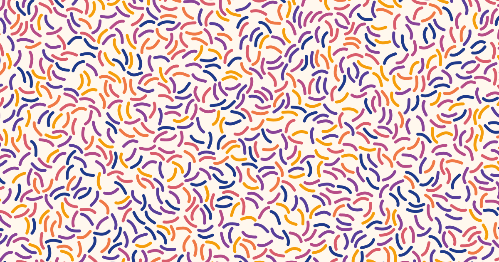

<h1> Pattern generator</h1>

Pack small SVG shapes (squiggles, dots, spirals, your own) into dense, non-overlapping patterns and seamless tiles. Runs in the browser, exports SVG.



## Features

- Shapes never touch: each keeps a configurable safe zone
- Colours from an even-looking OKLCH gradient
- Random rotation, size and stroke width; smooth or rough "pencil" strokes
- Edges: bleed & clip, keep inside, or seamless tile
- Same seed + settings = same pattern; export and import settings as JSON
- Works on phones

## Run

Needs Node 18+, no dependencies.

```sh
npm start   # http://localhost:8787
```

## Add shapes

Make a folder in `shapes/` and drop SVGs in it; it shows up in the shape menu. The procedural sets are generated with `node tools/make-shapes.mjs`.

## License

[MIT](LICENSE)
